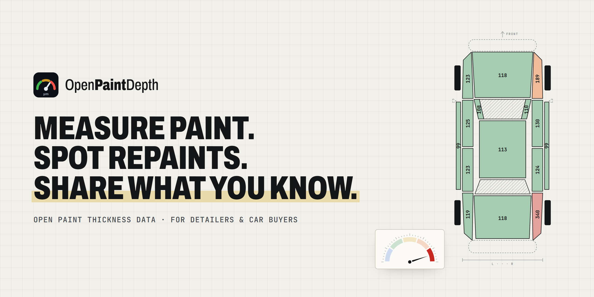
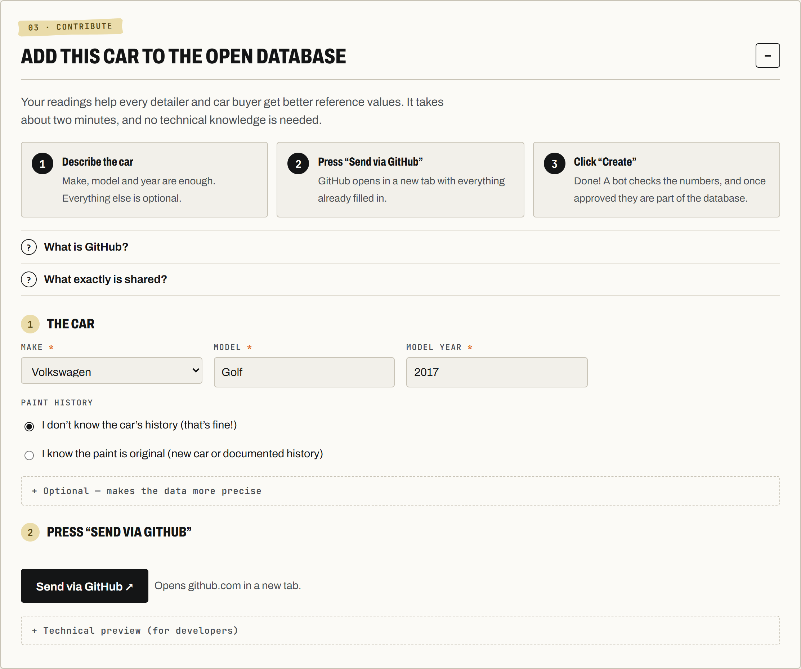

**Die offene, von der Community gepflegte Datenbank für Werkslack-Schichtdicken – pro Marke, Modell, Generation und Bauteil.** 
Dazu ein Nachlack- und Spachtel-Check, der offline in der Garage funktioniert.

[**App öffnen**](https://niklas1andonly.github.io/OpenPaintDepth/) · [Beispielauto ansehen](https://niklas1andonly.github.io/OpenPaintDepth/?example#check) · [English README](README.md)

## Warum?

Jeder Detailer mit Schichtdickenmessgerät hat dieselben zwei Fragen:

1. **Wie viel darf ich polieren?** Dafür muss man wissen, wie viel Lack das Auto ab Werk hatte.
2. **Ist das Bauteil nachlackiert oder gespachtelt?** Das wollen auch Gebrauchtwagenkäufer wissen.

Vergleichswerte stehen bisher nur verstreut in Foren oder in geschlossenen Tabellen mit einem groben Wert pro Modell.
OpenPaintDepth sammelt echte Messungen **pro Bauteil** als **offene Daten**, und alle können mitmachen.

## Was die App kann

- **Auto prüfen:** Werte auf dem Auto-Diagramm eintragen. Jedes Bauteil wird blau, grün, gelb, orange oder rot
  eingefärbt (dünn → original → genauer prüfen → nachlackiert → Spachtel), wie bei professionellen Messgeräten.
- **Ergebnis verstehen:** Gesamturteil mit Tacho, die auffälligen Bauteile und zu jedem Befund ein Abschnitt
  **„Was heißt das?“** in Alltagssprache.
- **Protokoll drucken:** Ein sauberes A4-Lackmessprotokoll mit Auto-Grafik, allen Werten, Notizen und Unterschrift,
  für Kunden oder den Gebrauchtwagenkauf. Über den Druckdialog auch als PDF.
- **Vergleichen:** Median und Normalbereich pro Bauteil für jedes Modell in der Datenbank.
- **Für unterwegs:** µm oder mil, Deutsch und Englisch, hell und dunkel, als App auf dem Handy installierbar,
  funktioniert ohne Netz. Deine Eingaben verlassen das Gerät nur, wenn du sie selbst teilst.

## Messwerte teilen, ganz ohne Technikwissen

1. **Auto in der App prüfen** wie gewohnt.
2. **„Dieses Auto zur offenen Datenbank hinzufügen“** öffnen, Marke wählen, Modell und Baujahr eintippen. Der Rest ist freiwillig.
3. Auf **„Über GitHub senden“** tippen. Es öffnet sich ein Tab, in dem alles schon ausgefüllt ist. Dort auf **„Create“** klicken. Fertig.

Ein Bot prüft die Werte automatisch. Nach der Freigabe ist dein Auto Teil der Referenz für alle.

<b>Was ist GitHub, und warum brauche ich ein Konto?</b>

GitHub ist die kostenlose Website, auf der OpenPaintDepth mit allen Daten offen gespeichert ist, ähnlich wie ein
öffentliches Archiv. So bleiben die Daten offen, und jeder sieht, woher sie kommen. Ein kostenloses Konto ist in
etwa einer Minute erstellt: [github.com/signup](https://github.com/signup).

<b>Was genau wird geteilt?</b>

Nur Automodell, Baujahr, die Lackangaben, die du einträgst, und die Messwerte. **Niemals** FIN, Kennzeichen, dein
Name oder Standort. Dein GitHub-Benutzername wird als Beitragende*r angezeigt.

<b>Ich kenne die Historie des Autos nicht. Hilft die Messung trotzdem?</b>

Ja. Wähle „Ich kenne die Historie nicht“. Offensichtliche Nachlackierungen werden automatisch aus der Referenz
herausgefiltert. Wenn du weißt, dass ein Teil nachlackiert ist, hak es an.

Die Messanleitung (auf Englisch) steht in [docs/measuring.md](docs/measuring.md), die Regeln des Checks in
[docs/methodology.md](docs/methodology.md).

## Lizenz

Code unter [MIT](LICENSE), Daten unter [ODbL 1.0](data/LICENSE.md).
