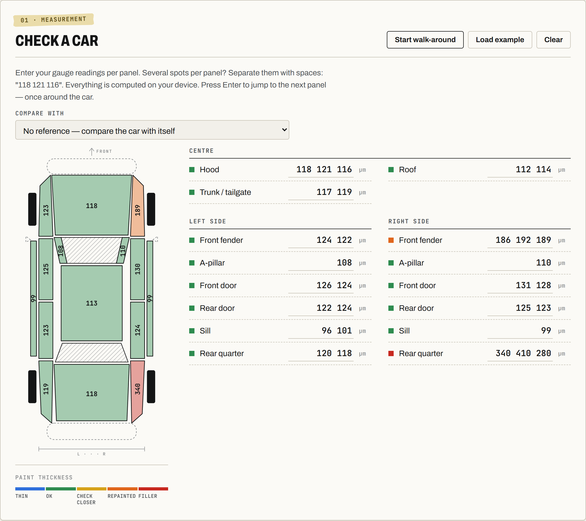
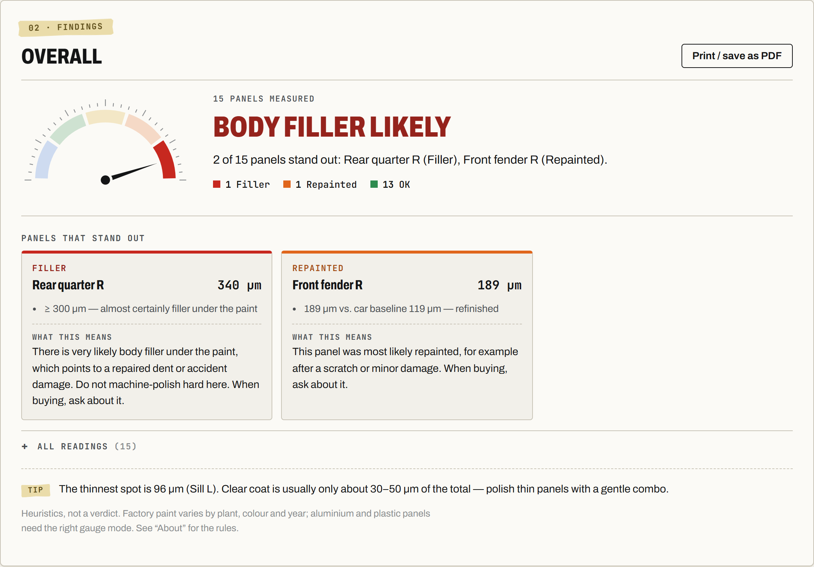
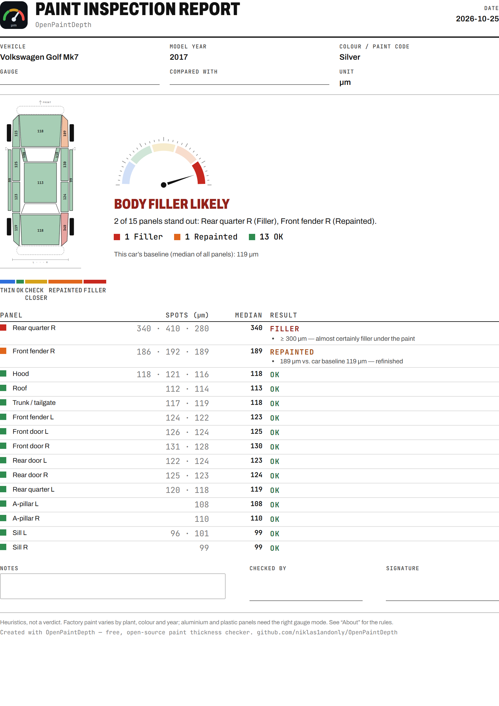
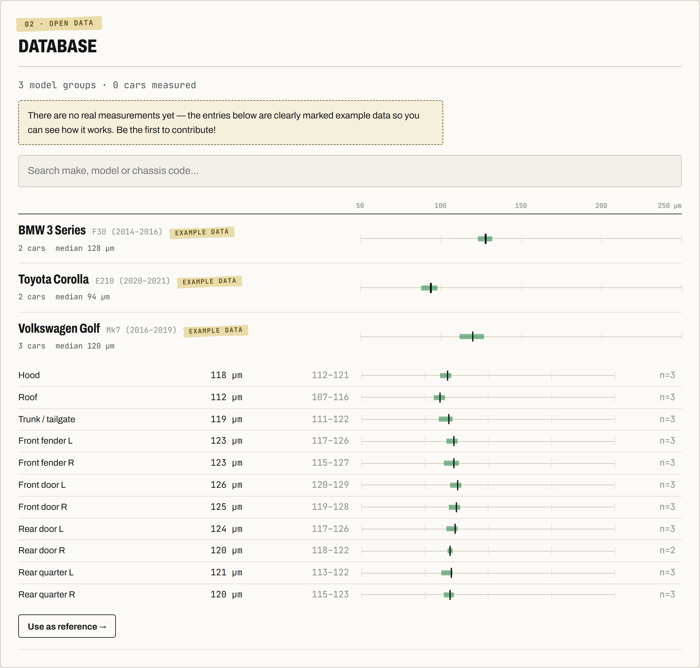

<div align="center">


**The open, community-built database of factory car paint thickness, per make, model, generation and panel.**<br>
Plus a repaint and body-filler checker that works offline, right in the garage.

[](https://niklas1andonly.github.io/OpenPaintDepth/)
[](https://niklas1andonly.github.io/OpenPaintDepth/?example#check)

[](https://github.com/niklas1andonly/OpenPaintDepth/actions/workflows/ci.yml)
[](LICENSE)
[](data/LICENSE.md)
[](#)

[Deutsch](README.de.md) · [How to measure](docs/measuring.md) · [How the checker decides](docs/methodology.md) · [Contributing](CONTRIBUTING.md)

</div>

<br>

<a href="docs/assets/launch-video.mp4"></a>

<p align="center"><sub><a href="docs/assets/launch-video.mp4">▶ Watch the full 43-second video (with sound)</a></sub></p>

---

## Why?

Every detailer with a paint gauge asks the same two questions:

1. **How much can I safely polish?** For that you need to know how much paint the car had from the factory.
2. **Has this panel been repainted, or is there filler underneath?** Used-car buyers ask this too.

The reference numbers are scattered across forum threads, or locked in closed charts with one rough value per
model. Nobody publishes them **per panel**, as **open data**, with **real measurements behind them**.
OpenPaintDepth does, and anyone can help build it.

## What you can do with it

<table>
<tr>
<td width="50%" valign="top">

### Check a car
Tap a panel on the car drawing and type what your gauge shows. Each panel turns
**blue, green, yellow, orange or red** (thin → original → check closer → repainted → filler), the same scale
professional gauges use. Press <kbd>Enter</kbd> to walk around the car.

</td>
<td width="50%"></td>
</tr>
<tr>
<td width="50%" valign="top">

### Understand the result
A plain-language verdict with a gauge, the panels that stand out, and **what each finding means**,
for example "there is very likely body filler under the paint, do not machine-polish hard here."

</td>
<td width="50%"></td>
</tr>
<tr>
<td width="50%" valign="top">

### Print a report
A clean one-page A4 inspection report with the car drawing, every reading, notes and a signature line.
Hand it to your customer, or take it to the used-car dealer. Save it as a PDF from the print dialog.

</td>
<td width="50%"></td>
</tr>
<tr>
<td width="50%" valign="top">

### Compare with the database
Median and normal range for every panel of every model the community has measured, on one shared scale.

</td>
<td width="50%"></td>
</tr>
</table>

Also: **µm or mils**, **English and German**, light and dark mode, and it **installs like an app on your phone**
(open the site, then "Add to Home Screen") and keeps working without signal. Nothing you type leaves your device
unless you decide to share it.

## Share your measurements, no tech skills needed

The database only grows if people share what they measure. It takes about two minutes:


1. **Check a car in the app** as usual.
2. Open **"Add this car to the open database"**, pick the make, type the model and year. Everything else is optional.
3. Press **"Send via GitHub"**. A new tab opens with everything already filled in. Click **"Create"**. Done.

A bot checks the numbers automatically, and once a maintainer approves, your car becomes part of the reference
for everyone.

<details>
<summary><b>What is GitHub, and why do I need an account?</b></summary>

GitHub is the free website where OpenPaintDepth and all of its data are stored openly, a bit like a public archive
that anyone can read and copy. Sending through GitHub keeps the data open and lets everyone see where it came
from. A free account takes about a minute: [github.com/signup](https://github.com/signup).
</details>

<details>
<summary><b>What exactly is shared?</b></summary>

Only the car model, year, the paint details you choose to enter, and the readings. **Never** a VIN, a plate
number, your name or your location. Your GitHub username is shown as the contributor.
</details>

<details>
<summary><b>I don't know the car's history. Is my measurement still useful?</b></summary>

Yes. Choose "I don't know the car's history". Obvious repaints are filtered out of the reference automatically.
If you know a panel was repainted, tick it, so it isn't counted as factory paint.
</details>

<details>
<summary><b>How do I measure properly?</b></summary>

Clean, dry panels, about three spots per panel, away from edges. The full guide is in [docs/measuring.md](docs/measuring.md).
</details>

> **Status:** freshly launched. The database ships with a few clearly labelled *example* records so you can
> see how it works. They never mix with real statistics. **Your car could be the first real measurement.**

## Roadmap

- [ ] First 100 real cars
- [ ] Bluetooth import from common paint gauges
- [ ] Your own workshop logo on the printed report
- [ ] Paint-code level statistics (some colours are thicker than others)
- [ ] More languages: FR, ES, IT, PL, NL… ([help wanted](CONTRIBUTING.md#translations))
- [ ] Versioned dataset releases for researchers

---

## For developers

The data is plain YAML in this repository, validated by a JSON Schema in CI. The app is Vite + TypeScript with no
runtime framework.

```bash
npm install
npm run dev        # app at http://localhost:5173 (add ?example to load the example car)
npm test           # unit tests
npm run validate   # check all data files
npm run build      # validate + build db.json + type-check + production build
```

One measured car is one file:

```yaml
schema: 1
vehicle:
  make: volkswagen
  model: Golf
  generation: Mk7
  year: 2016
  paint_type: metallic
condition: factory          # factory = known original paint, unknown = no known history
repaired_panels: [door_rr]  # left out of the reference statistics
readings:  # µm, one entry per measured spot
  hood: [118, 121, 116]
  roof: [112, 115, 110]
  door_rr: [214, 236, 221]
```

```
data/makes.yaml              canonical list of makes
data/measurements/**.yaml    one file per measured car  ← the open data
schema/                      JSON Schema for a measurement
src/core/                    shared logic: panels, statistics, checker rules, YAML writer
scripts/                     validate, build-db (→ web/public/db.json), issue intake bot
web/                         the app
.github/workflows/           CI, GitHub Pages deploy, issue → pull request intake
```

Submissions from the app arrive as GitHub issues. `.github/workflows/intake.yml` validates them and opens a
pull request automatically. See [CONTRIBUTING.md](CONTRIBUTING.md) for the details.

## License

- **Code:** [MIT](LICENSE)
- **Data** (`data/`): [Open Database License (ODbL) 1.0](data/LICENSE.md). Use it anywhere, including
  commercially, but credit OpenPaintDepth and keep derived databases open.
